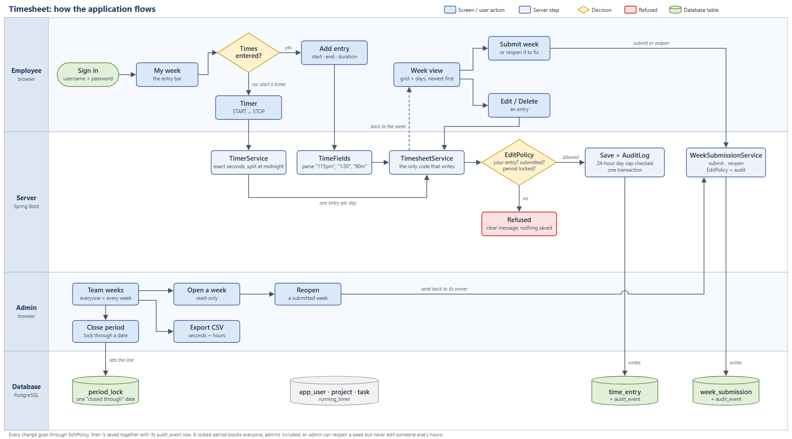
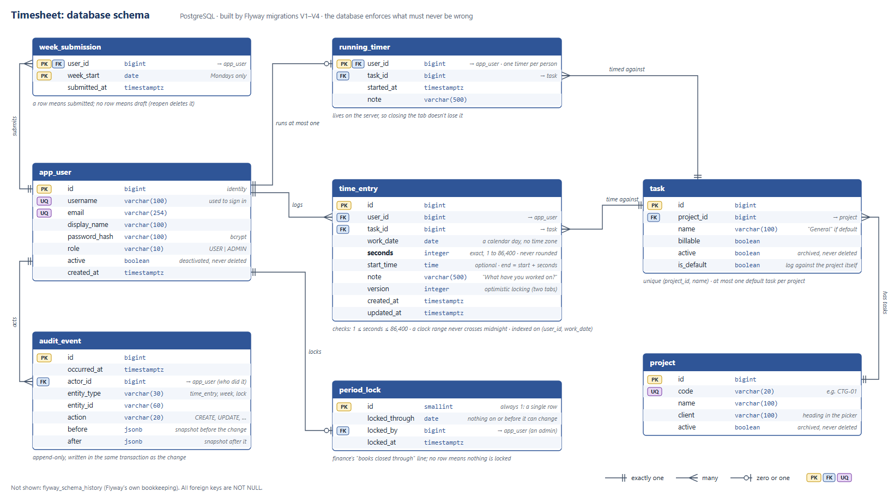

# Timesheet

A small timesheet app for a 40-person consultancy that bills by the hour, built to replace the shared spreadsheet that breaks every Friday. Java 21, Spring Boot 4, PostgreSQL, server-rendered HTML.



Every change, typed or timed, goes through `TimesheetService`, is checked by `EditPolicy`, and is saved together with its audit row. (Editable version: [`docs/app-flow.svg`](docs/app-flow.svg).)

## Run it

```bash
docker compose up --build
```

Then open http://localhost:8080 (port taken? `APP_PORT=8090 docker compose up --build`) and sign in with **`demo` / `demo`**. The sign-in page reminds you, but only in the demo setup.

| Username | Password | Role |
|---|---|---|
| `demo` | `demo` | Admin, so one sign-in reaches everything |
| `sam` | `demo` | User |
| `jo` | `demo` | User |

The demo setup creates these accounts, the ten CTG projects, and four weeks of sample time for Sam and Jo, shaped so the team view shows every state: submitted weeks, a draft Jo forgot to submit, and a week Jo logged nothing. Demo's own timesheet starts empty, so you can try entering time. To start fresh: `docker compose down -v`.

Or run it with Maven alone (JDK 21 and Docker running; no Compose, no Postgres to install):

```bash
./mvnw spring-boot:test-run -Dspring-boot.run.profiles=dev
```

That starts the app with a throwaway Postgres container (Testcontainers) and the demo data. It's handy for development, and the database is gone when you stop it. Add `-Dspring-boot.run.arguments=--server.port=8090` if 8080 is taken.

Run the tests (needs Docker running, for Testcontainers):

```bash
./mvnw verify
```

## A two-minute tour

1. **Sign in as `demo` / `demo`.** The cursor is in "What have you worked on?". Type anything, Tab to **Project**, type `fin`, Enter, Tab, type `905` over the start, Tab, `1042` over the end (they tidy to 9:05 AM and 10:42 AM, and the duration fills in), Enter. Add another with `1.5`: the project and day are kept. Durations show as h:mm:ss, like Clockify.
2. Click the clock icon at the right of the bar to switch to timer mode, then START (or press `t`). It ticks in the bar and in the header on every page; STOP or `t` logs it.
3. Click **Submit week**. The week goes read-only; **Reopen** brings it back.
4. Open **Team weeks** (demo is an admin): everyone × every week, with your time and a ✓ once a week is submitted. Jo's unsubmitted and empty weeks stand out, which is exactly what this page is for. Click a cell to see that week, then **Export CSV**.
5. Open **Close period** and lock through last month. Now nobody, admins included, can change those days.

## Scope

**Built:** everything in the must-haves, plus all three nice-to-haves: keyboard-first entry, a running timer, and period locks.

**Cut, on purpose:**
- Manager approval (see below), invoicing and billing rates.
- Admin screens for managing users, projects and tasks. They're seeded instead. This is the first thing I'd add next, and the schema already supports archiving.
- SSO, password reset and login throttling.
- A UI for browsing the audit log, i18n, and a JSON API.

**What I sweated:**
- That time is stored **exactly**.
- That every rule lives in **one place** and the UI can't disagree with it.
- That **nothing changes without an audit row**.
- That nobody can touch someone else's hours by editing a URL.
- That entering a day's time is fast from the keyboard.

### Where I pushed back on the spec

| Spec | What I did | Why |
|---|---|---|
| "Increments of your choosing" | **Exact seconds, no rounding** | Rounding is a billing rule, and billing is out of scope. Rounded data can't be un-rounded. |
| "Edit and delete; audit trail is your call" | **Hard delete plus an append-only audit log** | Soft delete puts a `where deleted = false` trap in every query that sums billable hours. |
| "Weekly submit step" | **Submit and reopen, no approval** | For 40 people the control that matters is finance closing the books, and that's the lock. |
| (implied) admin power | **Admins can't edit other people's hours** | A timesheet is that person's statement. Admins send a week back instead. |
| "Export totals as CSV" | **One flat row per person × week × task** | Finance can pivot it any way they like; any pre-totalled shape would be wrong for someone. |

## Data model



Eight tables, built by four small migrations: [`V1__schema.sql`](src/main/resources/db/migration/V1__schema.sql) (the model), [`V2__default_tasks.sql`](src/main/resources/db/migration/V2__default_tasks.sql) (log against a project directly), [`V3__seconds.sql`](src/main/resources/db/migration/V3__seconds.sql) (exact seconds) and [`V4__usernames.sql`](src/main/resources/db/migration/V4__usernames.sql) (sign in with a username). (Editable diagram: [`docs/schema.svg`](docs/schema.svg).)

| Table | Holds | Notes |
|---|---|---|
| `app_user` | people: username, email, `USER` or `ADMIN` | Deactivated, never deleted |
| `project`, `task` | what time is logged against | Archived, never deleted, so old entries always resolve. A project can have a hidden *default task* (`is_default`), so time can be logged against just the project |
| `time_entry` | user, task, `work_date`, `seconds`, optional `start_time`, note, `version` | The only time data |
| `week_submission` | (user, Monday) | A row means submitted; no row means draft |
| `period_lock` | one `locked_through` date | A single row (`id = 1`, check-constrained) |
| `running_timer` | one per user | The primary key is the "one timer each" rule |
| `audit_event` | who, what, when, JSON before/after | Append-only |

**The database enforces what must never be wrong:**
- `seconds` between 1 and 86,400 (one day).
- A clock range can't cross midnight.
- A week starts on a Monday.
- One lock, one timer per person.
- Foreign keys everywhere.

**The application enforces workflow:** submitted weeks, locks, ownership and the 24-hour daily cap.

`work_date` is a plain `date`, not a timestamp. The day you worked is a calendar fact, so there's no time-zone arithmetic on the main path. The one place that needs a zone (the timer and "today") uses the office zone from config.

## The shape of the code

A modular monolith, packaged by feature, not by layer:

```
identity    sign-in, CurrentUser, Actor
catalog     projects and tasks
tracking    time entries, weeks, submit/reopen, timer   ← the core
  domain      pure Java rules: TimeInput, WorkWeek, EditPolicy, TimerSplit, DailyLimit
  web         controllers and forms
period      the books-closed line
reporting   team overview and CSV
audit       the append-only log
shared      cross-cutting bits (exceptions, display formats, clock)
```

The seams worth looking at:

- **Rules are plain Java, with no Spring.** [`EditPolicy`](src/main/java/com/aryehgolob/timesheet/tracking/domain/EditPolicy.java) answers every "may this person change this?" question from simple inputs (`Actor`, owner, date, submitted?, lock). Services ask it; they never decide. The week page asks it too, to decide which buttons to show, so the UI and the server can't disagree.
- **One write path.** [`TimesheetService`](src/main/java/com/aryehgolob/timesheet/tracking/TimesheetService.java) is the only code that changes entries. Each use case does the same five things in one transaction: load, ask the policy, validate, save, audit. The timer reuses it rather than writing entries itself.
- **Writes go through JPA, reads through SQL.** Entries are written as JPA entities. Pages and reports are built with plain SQL into view records ([`WeekQueries`](src/main/java/com/aryehgolob/timesheet/tracking/WeekQueries.java), [`TeamReports`](src/main/java/com/aryehgolob/timesheet/reporting/TeamReports.java)). Each tool does what it's good at.
- **The domain never sees Spring Security.** Controllers turn the logged-in user into an `Actor(userId, admin)`, and that's all the rules know about who's asking. Swapping in SSO touches only `SecurityConfig`.
- **Controllers are thin.** They translate HTTP to a service call and back. Bad input comes back to the form with a message; rule violations become 403/404.

## Decisions in detail

### Time is exact seconds

- Stored as an `integer` number of seconds, like Clockify. Floats never touch the database. (It started as minutes; a timer then couldn't tell 5 seconds from 59, so [`V3__seconds.sql`](src/main/resources/db/migration/V3__seconds.sql) converts it, exactly.)
- Shown as `h:mm:ss` everywhere (`0:00:47`, `7:45:00`), so a duration can never be misread as a time of day or as minutes.
- You can type `1:07`, `1:07:30`, `67m`, `1h 7m`, `45s`, `1.5h` or a clock range like `9:05-10:42` (seconds optional) ([`TimeInput`](src/main/java/com/aryehgolob/timesheet/tracking/domain/TimeInput.java)). A range also keeps its start time. The end is derived from start plus seconds, so the two can't disagree.
- Decimal hours are taken exactly (`1.33` is 1:19:48). One that isn't a whole second is rejected, not silently rounded: `1.00001` → "3600.036 seconds, not a whole second. Did you mean 1:00:00?"
- A day can hold at most 24:00:00 across all your entries. Anything more is a typo.
- When invoicing exists, client-specific rounding ("6-minute increments") should happen there, once, from these exact seconds.

### Who can change what

- **A lock beats everything.** Nobody can change anything on or before the closed date, admins included.
- **Only the owner logs or edits their time.** Admins can view anyone's week and reopen it, but not rewrite it.
- **A submitted week is read-only** until it's reopened.
- **Guessing another user's entry id gets a 403**, and there are tests that try it over HTTP.
- **Two tabs editing the same entry:** the second save is refused using a version number (optimistic locking), instead of silently overwriting the first.

### Audit trail: hard delete plus an append-only log

Every create, update and delete of an entry, every submit and reopen, and every lock change writes an `audit_event` row recording who did it, along with JSON `before` and `after` snapshots.

- **Why not soft delete?** Every query would need `where deleted = false` forever, and forgetting it once double-counts billable hours. History belongs in the log, not the live table.
- **Why not event sourcing?** Too much machinery for 40 people. The question actually asked is "who changed this, and from what?", and one table answers it.
- **The audit row can't be skipped or orphaned.** [`AuditLog`](src/main/java/com/aryehgolob/timesheet/audit/AuditLog.java) requires an existing transaction (`Propagation.MANDATORY`), so a change and its audit row commit together or not at all. A test calls it outside a transaction and expects it to fail.
- An edit that changes nothing writes nothing and doesn't bump the version.
- The submit record stores the week's total at that moment, so "what did they submit?" stays answerable later.

### Submitting a week

A week is a **draft** until you press *Submit week*; then it's read-only. You can reopen your own week to fix something, and an admin can send anyone's week back.

- A week is submitted if it has a row in `week_submission`, and reopening deletes the row. There's no status column that can drift out of sync with reality.
- Submitting an empty week is allowed (holiday, sick week), after a confirm.

### Locking periods: one "closed through" date

- Closing the books is always "everything up to here", so a single date can't have holes and is trivial to reason about. Per-week or per-month flags can.
- **A week that straddles the line** (say the month ends on a Wednesday) stays editable on its open days. Submit and reopen are blocked only when the whole week is locked.
- An admin can move the line back or remove it (mistakes happen), and that's audited with before and after dates. You can't lock days that haven't happened yet.
- **Admin-only twice:** `/admin/**` is restricted by URL, *and* [`PeriodLockService`](src/main/java/com/aryehgolob/timesheet/period/PeriodLockService.java) and `TeamReports` check the role themselves, so a future endpoint that forgets can't open a hole.

### Admin: team weeks and the CSV export

**Team weeks** answers the Friday question, "who hasn't submitted?", at a glance. People who've left appear only if they logged time in the period. Periods are whole weeks (a mid-week start widens to the Monday), capped at a year.

**Export CSV:**

```
email,name,week_start,week_status,client,project_code,project,task,billable,seconds,hours
jo@example.com,Jo Chen,2026-09-28,submitted,CTG,CTG-02,Financial Management,General,yes,121500,33.75
```

- **`seconds` is exact and is the column to reconcile on.** `hours` is the same value to two decimals, for reading.
- **`week_status` is on every row**, so draft hours can't sneak into an invoice unnoticed.
- **Escaping:** quoting is done by Apache Commons CSV, not hand-rolled. Cells starting with `= + - @` get a leading `'`, so a project called `=HYPERLINK(...)` can't become a live formula in someone's spreadsheet (formula injection).

### The week page: a Clockify-style entry bar

The page leads with one bar, modelled on Clockify's tracker:

```
[ What have you worked on?   ] [⊕ Project] [ 1:15 PM ] - [ 2:45 PM ] [ date ] [ 1:30:00 ] [ ADD ]  ⏱ ☰
```

- **Description first, free text.** It's the entry's note. Then pick a project, then a time (manual mode) or press START (timer mode). **Leaving the times as they open (start = end, no duration) starts a timer from now**, because "I'm starting this" is the common case and there's no point making you switch modes for it. If a timer is already running, it's logged first. The two icons switch modes, the choice is remembered in the browser, and a running timer always shows in timer mode.
- **Start, end and duration, like Clockify.** Start and end open on the current time and keep up with the clock until you touch them; clicking one shows it compactly and selected (`221PM`) so you just type over it. Each box takes casual input (`9`, `915`, `115pm`, `1:15 PM`, `13:15`) and tidies it on blur. Change start or end and the duration follows; change the duration and the end moves. Either half is enough with a duration, or type a duration alone. [`TimeFields`](src/main/java/com/aryehgolob/timesheet/tracking/domain/TimeFields.java) is the one place that turns the three boxes into an entry; [`time-fields.js`](src/main/resources/static/js/time-fields.js) only previews it, and the server checks everything again. Clock times show on a 12-hour clock; 24-hour input works too.
- **The edit row is the same bar:** description, project (an entry can move to another project), start - end, duration. The day stays fixed; to move an entry to another day, delete and re-add it.
- **Project picker:** a searchable popover grouped under client headings ("CTG · 10 Projects"), with a colour dot per project and expandable tasks ("3 Tasks ⌄"). It works from the keyboard: Tab to it, type to search, arrows, Enter. Colours are derived from the project id, so there's nothing to manage.
- **"Project" versus the spec's "project + task":** most of the time people log against a project, as in Clockify. Each such project has a hidden *default task*, so every entry still has both and reports stay uniform. In reports the default task is called `General`; on screen you just see the project. A project that needs real tasks simply adds them.
- **Progressive enhancement:** the server renders a normal form with a plain `<select>`, and [`picker.js`](src/main/resources/static/js/picker.js) turns it into the popover. The select still holds the value, so submitting is unchanged and the page works without JavaScript. For 40 people the whole project list goes in the page, so there's no search API.
- **Day list:** only days with entries, newest first ("Today", "Yesterday", "Fri 16 Oct"), each with its total. The task × day grid above stays as the weekly rollup; entries are the source of truth.
- After adding, the project and day are kept and the cursor goes back to the description.
- `n` new entry · `[` `]` previous/next week · `t` start or stop the timer · `Esc` cancel an edit.
- Bad input, or a day that turns out to be locked, comes back as a message with exactly what you typed.
- Plain HTML forms, post/redirect/get, and about 350 lines of JavaScript in two files. No front-end build, no SPA, and it works at phone width.
- **Cut from Clockify:** tags, favourites, and creating projects from the picker (that's an admin job, and admin screens are the first item under next steps).

### Timer

- **It lives on the server**, one `running_timer` row per person. Closing the tab, restarting the laptop or switching devices doesn't lose it.
- **Stopping isn't special.** The time is cut at midnight ([`TimerSplit`](src/main/java/com/aryehgolob/timesheet/tracking/domain/TimerSplit.java)), and each piece goes through the same `TimesheetService.addEntry` as typed time, so the same rules, cap and audit apply. It records exactly how long it ran, to the second (start and stop times are the office wall clock). **Time is never thrown away:** a timer stopped within the second it started logs 0:00:01.
- **Starting another task while one runs** stops and logs the first, so switching is one action.
- **Forgotten timers:** after 10 hours the chip says *Review*, and the week page asks when you really stopped before logging anything, or lets you discard it.
- **If the time can't be logged** (the week was submitted or locked while it ran), the stop is refused and the timer keeps running, so nothing is silently lost.

### Authentication: form login and server sessions

Username and password (an email address works too), BCrypt, a session cookie, CSRF protection on every form. The demo password hint only appears when the demo data is loaded (the `dev` profile), never in a real install.

- **Why not JWT?** It's server-rendered, so there's no SPA or API client to hand a token to. Sessions are simpler and can be revoked.
- **What I'd really ship:** company SSO (Google Workspace or Microsoft 365 over OIDC). A 40-person consultancy already has one, and nobody wants another password. That's a swap of `formLogin` for `oauth2Login` in [`SecurityConfig`](src/main/java/com/aryehgolob/timesheet/identity/SecurityConfig.java); the rest of the app only sees `CurrentUser` and `Actor`.
- **Two roles,** `USER` and `ADMIN`, and that's all.
- **People who leave** are deactivated: their hours stay on the books and they can't sign in.

## Tests

About 150 tests, aimed at the parts that would hurt to get wrong:

- **Domain rules, plain JUnit, milliseconds to run:**
  - Parameterized tables for every input format and every rejection ([`TimeInputTest`](src/test/java/com/aryehgolob/timesheet/tracking/domain/TimeInputTest.java)).
  - The full owner/admin × submitted × locked matrix ([`EditPolicyTest`](src/test/java/com/aryehgolob/timesheet/tracking/domain/EditPolicyTest.java)).
  - Week boundaries across year ends and leap days.
  - Midnight splits.
- **Against real Postgres (Testcontainers), through the services:**
  - The daily cap across entries.
  - Stale edits.
  - Audit rows for every change, and none for refused or no-op ones.
  - Submit and reopen permissions.
  - Locks beating admins.
  - Timer splits and rollback.
- **Over HTTP (MockMvc):**
  - Sign-in edge cases.
  - Admin-only pages for a regular user.
  - CSRF.
  - Editing or deleting someone else's entry by id.
  - CSV quoting and formula injection, checked with a real CSV parser.
  - Pages rendering in each state.

All integration tests share one Spring context and one container, and isolate themselves by creating their own users rather than wiping tables, so the suite stays fast and safe to run in any order. CI runs `./mvnw verify` on every push.

## Known limitations and what I'd do next

1. **Admin screens for users, projects and tasks.** These are seeded today; this is the biggest real gap.
2. **SSO** in place of passwords.
3. **Reminders:** a Friday-afternoon nudge to people who haven't submitted, since the team page already knows who they are.
4. **An audit log viewer** per entry and per week. The data is there.
5. **Enforce the module boundaries** with an ArchUnit test, so the seams above can't erode.
6. **Small edges I know about and accepted:**
   - The 24-hour cap is checked in the application, so two simultaneous saves could in theory exceed it.
   - On the two daylight-saving days a year, a timer counts wall-clock time, not elapsed time.
   - The CSV streams straight from one query, which is plenty for 40 people and a year of data. A much bigger company would want it generated in the background.
