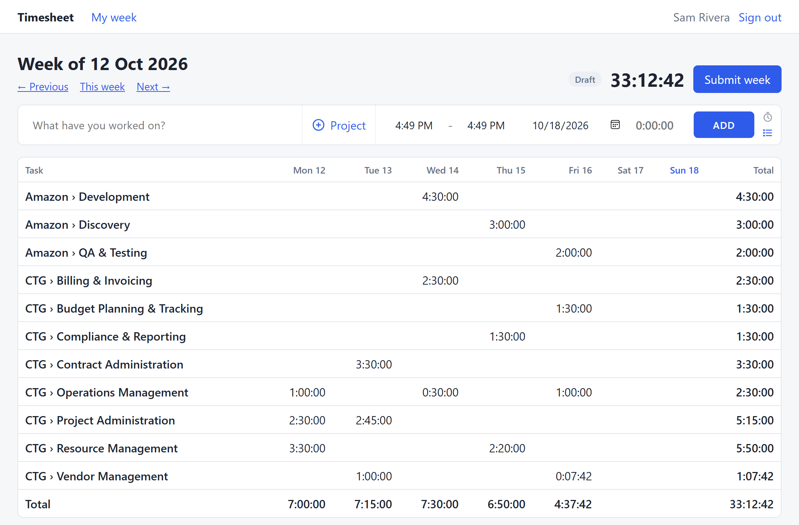
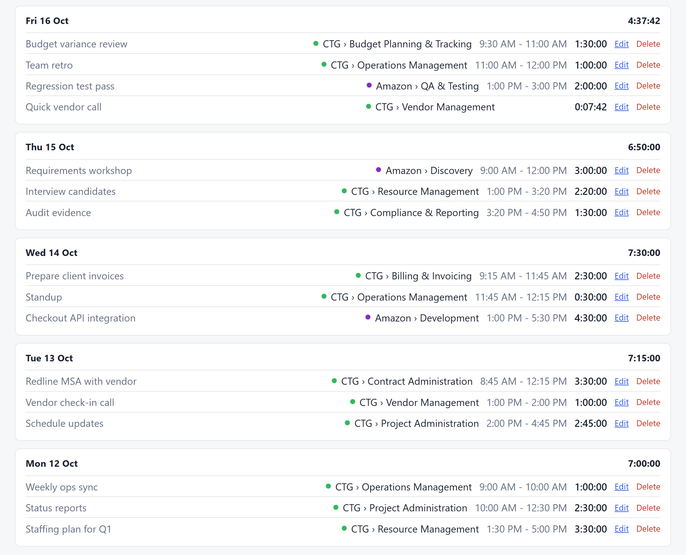
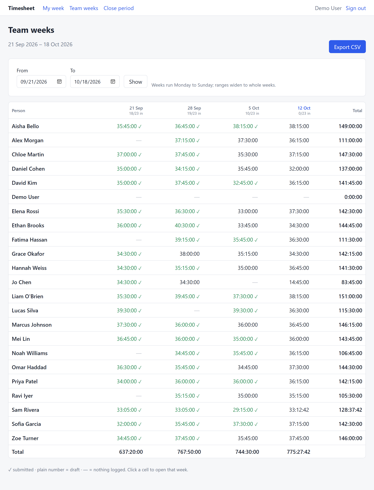

# Time Track Application

A timesheet app for logging time against projects and tasks. Type in what you worked on and when, or start a timer and stop it when you're done; every edit and delete is kept in an audit trail. Each person sees their week with daily and weekly totals and submits it when it's complete, while admins review everyone's weeks, lock closed periods, and export the hours to CSV. Built with Java 21, Spring Boot, PostgreSQL and server-rendered HTML.

## How to run

```bash
docker compose up --build
```

Open **http://localhost:8080** and sign in.

## Sign in

<table>
  <tr>
    <td width="55%">
      
    </td>
    <td>
      <b>Username:</b> <code>demo</code><br>
      <b>Password:</b> <code>demo</code>
      <br><br>
      The demo account is an admin, so it reaches everything: your own week, the team's weeks, period locks and the CSV export.
      <br><br>
      Every sample user (<code>sam</code>, <code>jo</code>, <code>grace</code>, and 19 more, all with password <code>demo</code>) comes with four weeks of logged time.
    </td>
  </tr>
</table>

## Log time: pick a project and task, add a note

Every entry is logged against a **project** and one of its **tasks**. A note is optional.

**1. Add a note (optional).** Type what you worked on in the first box, for example *Checkout API integration*. Leave it empty if the task says it all.

**2. Pick a project and task.** Click **Project** to open the picker. Click a project to unfold its tasks, then choose one. Or start typing to search across every project and task (typing `dev` finds *Amazon › Development*). The arrow keys and <kbd>Enter</kbd> work too.


**3. You're ready.** The bar shows your choice as *Project › Task*. Now record the time with **ADD** or **START**, as explained below.


## Add vs Start: two ways to log time

The entry bar at the top of **My week** has two modes. Both use the same description and project; they differ in *when* the time is recorded.

### Switch between them

The two small icons at the right end of the bar switch modes. The highlighted one is the mode you're in, and the app remembers your choice in this browser.

<table>
  <tr>
    <td align="center" width="90"></td>
    <td><b>Clock icon → Timer mode.</b> The button becomes <b>START</b>.</td>
  </tr>
  <tr>
    <td align="center" width="90"></td>
    <td><b>List icon → Manual mode.</b> The button becomes <b>ADD</b>.</td>
  </tr>
</table>

### START: time it as you go


- Type what you're working on, pick a project, and click **START** (or press <kbd>t</kbd>).
- The clock counts up, in the bar and in the page header. Click **STOP** when you're done.
- The entry is logged to the exact second. A timer left running past midnight is split into one entry per day.

### ADD: log time that already happened


- Fill in the start and end times (or just a duration, like `1:30`) and the day, then click **ADD**.
- The entry is saved straight away. The project and day stay filled in, ready for the next one.
- Times are forgiving: `9`, `915`, `1:15 PM` and `1715` all work.

> [!TIP]
> **ADD with no time behaves like START.** The start and end times default to *now*. If you click **ADD** while they're still equal and there's no duration, nothing is logged yet. A timer starts from now instead, exactly as if you'd clicked **START**.

<details>
<summary>Side-by-side diagram</summary>


</details>

## Your week at a glance

The front page sums up your week. Here's what a real week looks like: Sam's sample week, with 16 entries across both projects.

### The summary



- **Week total and status.** The large number is the week's total (here 33:12:42). The badge shows whether the week is a **Draft** or **Submitted**.
- **The grid.** There's one row per *Project › Task* and one column per day. The **Total** row and column give daily and per-task sums, so the time that goes on each task is easy to see.
- **Move between weeks** with *← Previous*, *This week* and *Next →*, or the <kbd>[</kbd> and <kbd>]</kbd> keys.
- **Submit week** when it's complete. It then becomes read-only, and an admin sees it as submitted.

### Every entry, day by day



- Each day you logged time gets a card with its total. The newest day comes first, and days with no time are left out.
- Each entry shows its note, its *Project › Task* (with the project's colour), its start and end times, and its exact duration.
- **Edit** opens the entry in place, where you can change the times, the note or the task. **Delete** removes it. Both are recorded in the audit trail.

## Team weeks (admins)

Admins get a **Team weeks** page: everyone's hours, week by week, on one screen. It answers the Friday question, *"who hasn't submitted yet?"*, at a glance. The demo data fills it with a team of 22 people and four weeks of time, over 1,200 entries in all.



**Reading the grid**

| You see | It means |
|---|---|
| <code>36:45:00 ✓</code> in green | The week is **submitted** |
| <code>38:00:00</code> plain | The week is a **draft**: time is logged but not submitted yet |
| <code>—</code> | **Nothing logged** that week (on leave, or someone to chase) |
| <code>19/23 in</code> under a week | How many people have submitted that week |

- **Click any cell** to open that person's week, exactly as they see it.
- **Pick a range** with *From* / *To* and click **Show**. Ranges widen to whole weeks (Monday to Sunday).
- The **Total** row and column give hours per week and per person.

**Export CSV** downloads the same range with one row per person, week and task, ready for payroll or invoicing:

```
email,name,week_start,week_status,client,project_code,project,task,billable,seconds,hours
sam@example.com,Sam Rivera,2026-10-05,submitted,,AMZ,Amazon,Development,yes,16200,4.50
sam@example.com,Sam Rivera,2026-10-05,submitted,,AMZ,Amazon,Discovery,yes,10800,3.00
grace@example.com,Grace Okafor,2026-09-28,draft,,AMZ,Amazon,Deployment,yes,46800,13.00
```

`seconds` is exact, and `week_status` is on every row, so draft hours can't slip into an invoice unnoticed.
