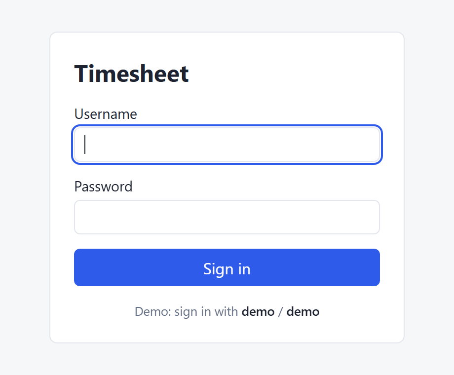
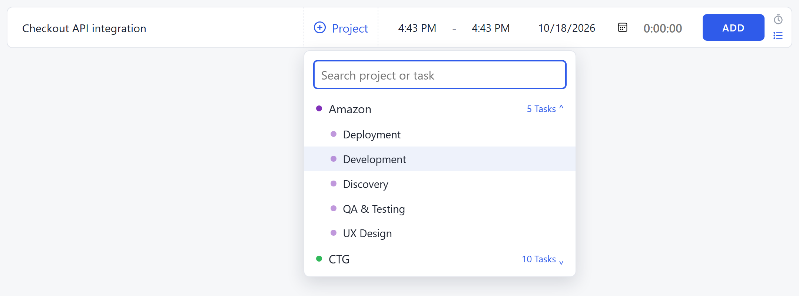
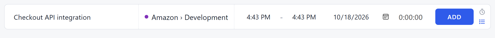
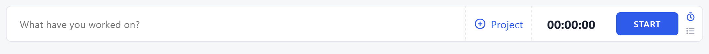
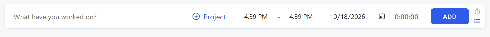
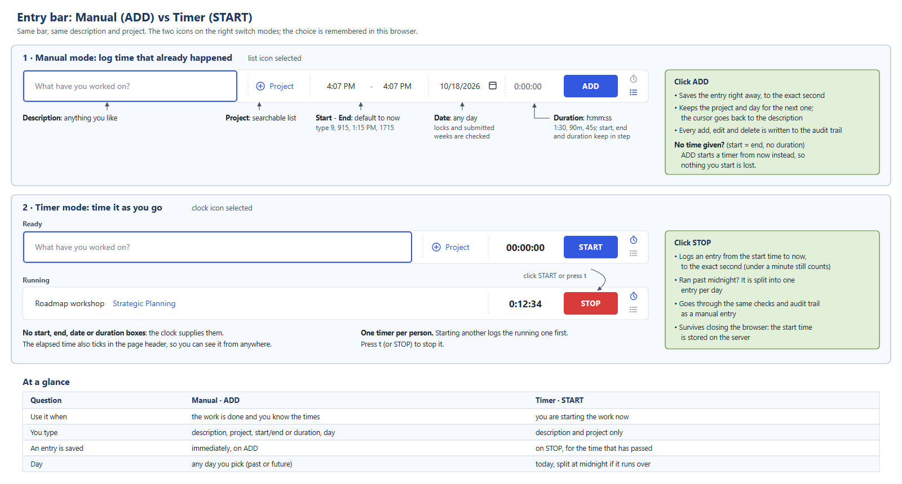

# Time Track Application

A timesheet app for logging time against projects and tasks. Type in what you worked on and when, or start a timer and stop it when you're done; every edit and delete is kept in an audit trail. Each person sees their week with daily and weekly totals and submits it when it's complete, while admins review everyone's weeks, lock closed periods, and export the hours to CSV. Built with Java 21, Spring Boot, PostgreSQL and server-rendered HTML.

## How to run

```bash
docker compose up --build
```

Open **http://localhost:8080** and sign in.

## Sign in

<table>
  <tr>
    <td width="55%">
      
    </td>
    <td>
      <b>Username:</b> <code>demo</code><br>
      <b>Password:</b> <code>demo</code>
      <br><br>
      The demo account is an admin, so it reaches everything: your own week, the team's weeks, period locks and the CSV export.
      <br><br>
      Sample users <code>sam</code> and <code>jo</code> (password <code>demo</code>) come with a few weeks of logged time.
    </td>
  </tr>
</table>

## Log time: pick a project and task, add a note

Every entry is logged against a **project** and one of its **tasks**. A note is optional.

**1. Add a note (optional).** Type what you worked on in the first box, for example *Checkout API integration*. Leave it empty if the task says it all.

**2. Pick a project and task.** Click **Project** to open the picker. Click a project to unfold its tasks, then choose one. Or start typing to search across every project and task (typing `dev` finds *Amazon › Development*). The arrow keys and <kbd>Enter</kbd> work too.



**3. You're ready.** The bar shows your choice as *Project › Task*. Now record the time with **ADD** or **START**, as explained below.



## Add vs Start: two ways to log time

The entry bar at the top of **My week** has two modes. Both use the same description and project; they differ in *when* the time is recorded.

### Switch between them

The two small icons at the right end of the bar switch modes. The highlighted one is the mode you're in, and the app remembers your choice in this browser.

<table>
  <tr>
    <td align="center" width="90"></td>
    <td><b>Clock icon → Timer mode.</b> The button becomes <b>START</b>.</td>
  </tr>
  <tr>
    <td align="center" width="90"></td>
    <td><b>List icon → Manual mode.</b> The button becomes <b>ADD</b>.</td>
  </tr>
</table>

### START: time it as you go



- Type what you're working on, pick a project, and click **START** (or press <kbd>t</kbd>).
- The clock counts up, in the bar and in the page header. Click **STOP** when you're done.
- The entry is logged to the exact second. A timer left running past midnight is split into one entry per day.

### ADD: log time that already happened



- Fill in the start and end times (or just a duration, like `1:30`) and the day, then click **ADD**.
- The entry is saved straight away. The project and day stay filled in, ready for the next one.
- Times are forgiving: `9`, `915`, `1:15 PM` and `1715` all work.

> [!TIP]
> **ADD with no time behaves like START.** The start and end times default to *now*. If you click **ADD** while they're still equal and there's no duration, nothing is logged yet. A timer starts from now instead, exactly as if you'd clicked **START**.

<details>
<summary>Side-by-side diagram</summary>



</details>
